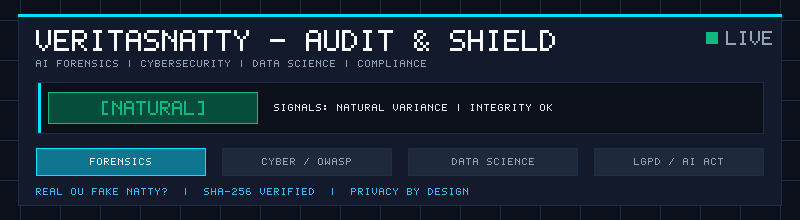

<p align="center">
  
</p>

<p align="center">
  <a href="./README.md">Português (PT-BR)</a> | <strong>English (EN)</strong> | <a href="./README.es.md">Español (ES)</a>
</p>

<p align="center">
  <a href="https://github.com/luscaalvespereira/lab-natty-or-not/actions/workflows/ci.yml"></a>
  
  
  
  
</p>

# VeritasNatty — Audit & Shield

> *"Natural or Fake Natty? Don't trust appearances — audit the data, harden the code, close the legal gap."*

**Live Web App (Vercel):** [https://lab-natty-or-not-blue.vercel.app/](https://lab-natty-or-not-blue.vercel.app/)  
**DIO Lab Challenge:** *Natural ou Fake Natty? Como Vencer na Era das IAs Generativas!* (`#LabDIONattyOrNot`)

---

## 📒 Description

**VeritasNatty — Audit & Shield** turns DIO's *"Natural or Fake Natty?"* challenge into a **trilingual interactive Web App combining Digital Forensics, Data Science, Defensive Cybersecurity (Blue Team), and Legal Compliance**, running **100% client-side** (*Privacy by Design*, zero user text or file uploads leave the browser).

Every assessment explicitly answers **Yes/No (risk level), How, Why, and How to Defend** across four real-world challenges:
1. **Voice-cloning scams (*vishing*) and realistic synthetic media**;
2. **Persuasive LLM hallucinations** and the statistical limits of automated text detectors;
3. **New AI attack surfaces** (*Prompt Injection*, *Shadow AI*, unsegmented hospital/enterprise RAG);
4. **Regulatory and technical gaps** across **Brazilian LGPD**, **Brazil AI Bill (PL 2338/2023)**, **EU AI Act**, **GDPR**, **Criminal Fraud (Art. 171 §2º-A CP)**, and **Digital Chain of Custody (Arts. 158-A–158-F CPP)**.

---

## 🤖 Technologies & Architecture

- **Frontend & Runtime:** Semantic HTML5, responsive CSS3, pure ES Modules (zero external frameworks, zero runtime dependencies, zero exposed API keys);
- **Data Science & Epistemology (`src/engine/textForensics.js`):** Shannon Entropy $H(X)$, sentence-length descriptive stats with Tukey ($1.5 \times \text{IQR}$) outlier detection, L2-normalized TF-IDF cosine similarity, and explicit Turing (1950) / Searle (1980) epistemic limits;
- **Digital Forensics & Provenance (`src/engine/fileForensics.js` + `scripts/generate-manifest.mjs`):** Local Web Crypto **SHA-256** hashing, Magic Bytes verification, `EXIF`/`XMP`/`C2PA` scanning, and verifiable [provenance-manifest.json](./assets/provenance-manifest.json);
- **Defensive Cybersecurity (`src/engine/securityEngine.js`):** 512-bit deterministic **Bloom Filter**, **OWASP LLM Top 10 / Agentic / HackAPrompt** scanner, local DLP for PII/healthcare records, and 4-layer **Prompt Hardening** (Unicode sanitization + cryptographic Nonce boundary + angle-bracket escaping + Canary Token);
- **Legal & Fairness Engine (`src/engine/legalCompliance.js`):** Cross-framework compliance & gap mapper, **Disparate Impact (Four-Fifths 80% Rule)** & proxy variable auditor, and empirical token energy/water/CO₂e estimator;
- **Deployment Security & CI:** Production HTTP security headers in [vercel.json](./vercel.json), automated `node --test` suite (`tests/engine.test.mjs`), and GitHub Actions SHA-256 verification (`.github/workflows/ci.yml`).

---

## 🧐 Creation Process

1. **Decoupled Pure Engines:** All 5 logic engines in `src/engine/` contain zero DOM or Node-specific imports so the exact same code runs natively in browsers and in automated Node.js tests.
2. **Controlled Visual Realism Experiment (v1 vs. v2):** Generated `case-social-eng-v1.png` (naive prompt exposing classic plastic skin and artificial symmetry) alongside `case-social-eng-v2.png` (directed 35mm documentary prompt), demonstrating why visual inspection alone fails without cryptographic provenance.
3. **Technical Documentation:** See [docs/ARCHITECTURE.md](./docs/ARCHITECTURE.md), [docs/PROMPT_ENGINEERING_LOG.md](./docs/PROMPT_ENGINEERING_LOG.md), and [docs/LEGAL_SECURITY_GAPS.md](./docs/LEGAL_SECURITY_GAPS.md).

---

## 🚀 Results & Local Execution

```bash
# Run unit tests across all 5 engines (Node.js >= 20, zero external packages)
npm test

# Verify SHA-256 hashes of all tracked assets
npm run verify

# Start local security-hardened static server at http://127.0.0.1:4173/
npm start
```

---

## 💭 Reflection

Generating persuasive synthetic outputs is trivial today; building software that resists social engineering, prevents sensitive data leaks in enterprises and hospitals, and acknowledges statistical uncertainty is what separates production engineering from naive AI demos.

---

## 👤 Author

**Lucas Alves Pereira** — Law Graduate, Software Developer, and Researcher in Cybersecurity, Data Science & AI Governance · [@luscaalvespereira](https://github.com/luscaalvespereira)  
Original Lab inspiration: [digitalinnovationone/lab-natty-or-not](https://github.com/digitalinnovationone/lab-natty-or-not) (`@falvojr` / DIO).
