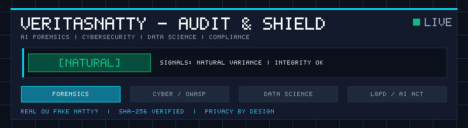

<p align="center">
  
</p>

<p align="center">
  <a href="./README.md">Português (PT-BR)</a> | <a href="./README.en.md">English (EN)</a> | <strong>Español (ES)</strong>
</p>

<p align="center">
  <a href="https://github.com/luscaalvespereira/lab-natty-or-not/actions/workflows/ci.yml"></a>
  
  
  
  
</p>

# VeritasNatty — Audit & Shield

> *"¿Natural o Fake Natty? No confíes en las apariencias — audita los datos, blinda el código y cierra la brecha jurídica."*

**Web App en vivo (Vercel):** `https://lab-natty-or-not.vercel.app` *(actualiza tras importar en Vercel)*  
**Desafío DIO:** *Natural ou Fake Natty? Como Vencer na Era das IAs Generativas!* (`#LabDIONattyOrNot`)

---

## 📒 Descripción

**VeritasNatty — Audit & Shield** transforma el laboratorio *"Natural or Fake Natty?"* de [DIO](https://www.dio.me/) en una **aplicación web trilingüe de Auditoría Forense, Ciencia de Datos, Ciberseguridad Defensiva y Cumplimiento Jurídico**, ejecutada **100% en el navegador** (*Privacy by Design*, sin envío de archivos ni textos a servidores externos).

Cada módulo responde explícitamente **Sí/No (nivel de riesgo), Cómo, Por Qué y Cómo Protegerse** frente a cuatro amenazas concretas:
1. **Estafas con clonación de voz (*vishing*) y contenido visual sintético**;
2. **Alucinaciones persuasivas de LLMs** y limitaciones estadísticas de detectores automáticos;
3. **Nuevas superficies de ataque** (*Prompt Injection*, *Shadow AI*, RAG hospitalario/corporativo sin control de acceso);
4. **Brechas jurídicas** en la aplicación práctica de **LGPD**, **PL 2338/2023 (Brasil)**, **EU AI Act**, **GDPR** y **Cadena de Custodia Digital**.

---

## 🤖 Tecnologías Utilizadas

- **Frontend:** HTML5 semántico, CSS3 adaptable y ES Modules nativos (cero dependencias externas);
- **Ciencia de Datos (`src/engine/textForensics.js`):** Entropía de Shannon $H(X)$, *burstiness*, detección de valores atípicos de Tukey ($1.5 \times \text{IQR}$) y similitud TF-IDF normalizada en L2;
- **Forense Digital (`src/engine/fileForensics.js`):** Hash **SHA-256** local vía Web Crypto API, validación por *Magic Bytes* e inspección de metadatos `EXIF`/`XMP`/`C2PA`;
- **Ciberseguridad Defensiva (`src/engine/securityEngine.js`):** Filtro de Bloom (512 bits / 4 hashes), escáner **OWASP LLM / HackAPrompt**, DLP local (PII/salud) y blindaje de prompts en 4 capas (Sanitización Unicode + Nonce dinámico + Canary Token);
- **Cumplimiento y Equidad (`src/engine/legalCompliance.js`):** Mapa normativo LGPD / PL 2338 / EU AI Act / GDPR, auditoría de **Disparate Impact (Regla del 80%)** y estimación de huella material;
- **Producción y CI:** cabeceras HTTP de seguridad en [vercel.json](./vercel.json) y pruebas automatizadas (`node --test`) con verificación SHA-256 en GitHub Actions.

---

## 🧐 Proceso de Creación

1. **Motores desacoplados:** los cinco módulos lógicos en `src/engine/` se ejecutan de forma idéntica en el navegador y en la suite automatizada de Node.js.
2. **Experimento controlado de realismo (v1 vs. v2):** comparación directa entre retrato generado con prompt ingenuo (`v1`) y escena documental dirigida (`v2`), demostrando la necesidad de trazabilidad criptográfica frente al criterio puramente visual.
3. **Documentación técnica:** consulta [docs/ARCHITECTURE.md](./docs/ARCHITECTURE.md), [docs/PROMPT_ENGINEERING_LOG.md](./docs/PROMPT_ENGINEERING_LOG.md) y [docs/LEGAL_SECURITY_GAPS.md](./docs/LEGAL_SECURITY_GAPS.md).

---

## 🚀 Resultados y Ejecución Local

```bash
npm test     # Ejecuta pruebas unitarias sobre los 5 motores (Node.js >= 20)
npm run verify  # Valida los hashes SHA-256 frente al manifiesto de procedencia
npm start    # Inicia el servidor local en http://127.0.0.1:4173/
```

---

## 💭 Reflexión

La inteligencia artificial generativa produce textos, imágenes y voces convincentes con facilidad, pero solo la unión entre fundamentos estadísticos, ciberseguridad defensiva y rigor jurídico permite transformar prototipos en sistemas confiables y auditables.

---

## 👤 Autor

**Lucas Alves Pereira** — Graduado en Derecho, Desarrollador e Investigador en Ciberseguridad, Ciencia de Datos y Gobernanza de IA · [@luscaalvespereira](https://github.com/luscaalvespereira)  
Referencia del laboratorio original: [digitalinnovationone/lab-natty-or-not](https://github.com/digitalinnovationone/lab-natty-or-not) (`@falvojr` / DIO).
