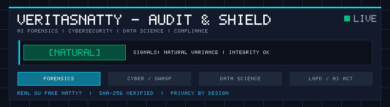
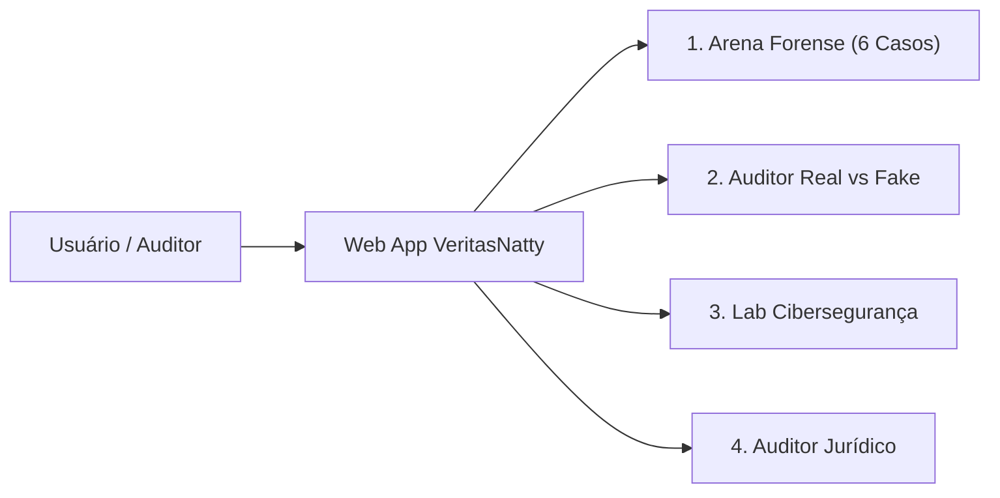

<p align="center">
  
</p>

<p align="center">
  <strong>Português (PT-BR)</strong> | <a href="./README.en.md">English (EN)</a> | <a href="./README.es.md">Español (ES)</a>
</p>

<p align="center">
  <a href="https://github.com/luscaalvespereira/lab-natty-or-not/actions/workflows/ci.yml"></a>
  
  
  
  
</p>

# VeritasNatty — Audit & Shield

> *"Real ou Fake Natty? Não confie na aparência — audite os dados, blinde o código e feche a lacuna jurídica."*

**Web App ao vivo (Vercel):** [https://lab-natty-or-not-blue.vercel.app/](https://lab-natty-or-not-blue.vercel.app/)  
**Desafio DIO:** *Natural ou Fake Natty? Como Vencer na Era das IAs Generativas!* (`#LabDIONattyOrNot`)

---

## 📒 Descrição

O **VeritasNatty — Audit & Shield** transforma o desafio *"Natural ou Fake Natty?"* da [DIO](https://www.dio.me/) em um **Web App interativo de Auditoria Forense, Ciência de Dados, Cibersegurança Defensiva e Compliance Jurídico**, executando **100% no navegador do usuário** (*Privacy by Design*, sem envio de textos ou arquivos a servidores externos).

O projeto responde de forma transparente — **Sim/Não (nível de risco), Como, Por Quê e Como se Proteger** — a quatro problemas reais do mercado:
1. **Golpes com clonagem de voz (*vishing*) e mídia sintética** cada vez mais difíceis de distinguir a olho nu;
2. **Alucinações convincentes de LLMs** e os limites estatísticos de detectores automáticos;
3. **Novas superfícies de ataque (*Prompt Injection*, *Shadow AI*, RAG sem controle de acesso)** ao conectar IA em empresas e hospitais;
4. **Lacunas jurídicas** no cumprimento prático de **LGPD**, **Marco Legal da IA (PL 2338/2023)**, **EU AI Act**, **GDPR**, **Código Penal (Art. 171 §2º-A)** e **Cadeia de Custódia Digital (CPP Arts. 158-A a 158-F)**.

---

## 🤖 Tecnologias Utilizadas

- **Core & Interface Web:** HTML5 semântico, CSS3 responsivo, JavaScript ES Modules puro (zero frameworks externos, zero chaves de API expostas);
- **Ciência de Dados & Epistemologia (implementados do zero em `src/engine/textForensics.js`):**
  - Entropia de Shannon $H(X)$ e Redundância Informacional;
  - Estatística Descritiva, *Burstiness* e detecção de outliers pela Regra de Tukey ($1.5 \times \text{IQR}$);
  - Similaridade TF-IDF com normalização L2;
  - Referenciais de Alan Turing (1950) e John Searle (1980) sobre limites de detecção estatística.
- **Forense Digital & Proveniência (`src/engine/fileForensics.js` + `scripts/generate-manifest.mjs`):**
  - Hash criptográfico **SHA-256** via Web Crypto API / Node `crypto`;
  - Inspeção local de *Magic Bytes* (`PNG`, `JPEG`, `GIF`, `WEBP`, `PDF`) e blocos `EXIF`, `XMP`, `C2PA`;
  - Manifesto verificável em [assets/provenance-manifest.json](./assets/provenance-manifest.json).
- **Cibersegurança Defensiva (`src/engine/securityEngine.js`):**
  - **Filtro de Bloom** determinístico (512 bits / 4 hashes);
  - Scanner **OWASP LLM Top 10** / **OWASP Agentic** / **HackAPrompt** (5 eixos);
  - Scanner DLP local (CPF, e-mail, chaves de API, menções a prontuário/CID-10);
  - **Prompt Hardening** em 4 camadas (Sanitização Unicode + Delimitador Nonce dinâmico + Escapamento + Canary Token).
- **Compliance & Equidade (`src/engine/legalCompliance.js`):**
  - Diagnóstico cruzado **LGPD**, **PL 2338/2023**, **EU AI Act**, **GDPR**, **CP** e **CPP**;
  - Calculadora de **Disparate Impact (Regra dos 80%)** e detecção de variáveis proxy discriminatórias;
  - Estimador paramétrico de pegada material (kWh, litros de água, kg CO₂e).
- **Produção, Segurança & CI:** `vercel.json` com HTTP Security Headers reais (CSP, X-Frame-Options, Referrer-Policy, Permissions-Policy), suíte automatizada com `node --test` e pipeline em `.github/workflows/ci.yml`.
- **IA Generativa nos Ativos do Lab:** criação controlada de 3 imagens sintéticas (`case-hospital-ai.png`, `case-social-eng-v1.png`, `case-social-eng-v2.png`) documentadas passo a passo no log de prompts.

---

## 🧐 Processo de Criação



1. **Arquitetura desacoplada:** toda a matemática, segurança e regras jurídicas residem em módulos puros (`src/engine/*.js`) sem dependência de DOM, permitindo validar exatamente o mesmo código tanto no navegador quanto em testes automatizados Node.js.
2. **Experimento visual controlado (v1 vs. v2):** produzimos intencionalmente uma imagem de retrato com prompt ingênuo (`v1` — evidenciando textura plástica e simetria artificial) e uma cena documental com prompt dirigido (`v2` — simulando fotografia 35mm), demonstrando na prática por que a inspeção visual falha sem rastreabilidade criptográfica.
3. **Documentação completa dos bastidores:** consulte [docs/ARCHITECTURE.md](./docs/ARCHITECTURE.md), [docs/PROMPT_ENGINEERING_LOG.md](./docs/PROMPT_ENGINEERING_LOG.md) e [docs/LEGAL_SECURITY_GAPS.md](./docs/LEGAL_SECURITY_GAPS.md).

---

## 🚀 Resultados

### Os 4 Módulos do Web App
1. **Arena Forense ("Natural ou Fake Natty?"):** 6 casos embaralhados via `Fisher-Yates O(n)` cobrindo *vishing* por clonagem de voz, alucinação clínica em dashboard hospitalar, imagens sintéticas `v1` vs. `v2`, nota jurídica humana autoral e integração de código vulnerável — revelando sempre **Sim/Não, Como, Por Quê e Defesa**.
2. **Auditor Estatístico & Forense de Arquivos:** cole qualquer texto para medir Entropia de Shannon, Burstiness, Outliers de Tukey e Similaridade TF-IDF (com aviso explícito de limitação epistêmica) ou inspecione qualquer arquivo local para gerar seu SHA-256 e ler cabeçalhos `EXIF`/`C2PA`.
3. **Lab de Cibersegurança Defensiva:** teste payloads de Prompt Injection, comandos destrutivos ou vazamento de prontuário/CPF no scanner Bloom/DLP e gere automaticamente uma versão blindada com Nonce e Canary Token, além de explorar o mapa de portas abertas em hospitais e empresas.
4. **Auditor Jurídico, Equidade & Pegada:** gere relatório de obrigações e lacunas normativas por setor, audite viés estatístico pela Regra dos 80% e estime impacto material de inferência.

### Executar e Testar Localmente (Node.js ≥ 20, zero dependências externas)

```bash
# 1. Rodar toda a suíte de testes unitários dos motores
npm test

# 2. Verificar integridade criptográfica SHA-256 contra o manifesto
npm run verify

# 3. Subir o servidor local seguro e abrir http://127.0.0.1:4173/
npm start
```

---

## 💭 Reflexão

Criar conteúdos sintéticos realistas com IA é fácil; difícil é construir sistemas que **não se deixem enganar por uma mentira convincente** e que **protejam pessoas reais contra vazamentos, fraudes e decisões opacas**. A lição central deste laboratório é que fundamentos de Computação, Estatística, Cibersegurança e Direito não são opcionais na era generativa — eles são a única barreira entre protótipos frágeis e software confiável.

---

## 👤 Autor & Atribuição

- **Autor:** **Lucas Alves Pereira** — Formado em Direito, Desenvolvedor e Pesquisador em Cibersegurança, Ciência de Dados e Governança de IA.
- **GitHub:** [@luscaalvespereira](https://github.com/luscaalvespereira)
- **Créditos do Desafio Original:** [digitalinnovationone/lab-natty-or-not](https://github.com/digitalinnovationone/lab-natty-or-not) — Venilton FalvoJr (`@falvojr`) e Digital Innovation One (DIO) · `#LabDIONattyOrNot`.
