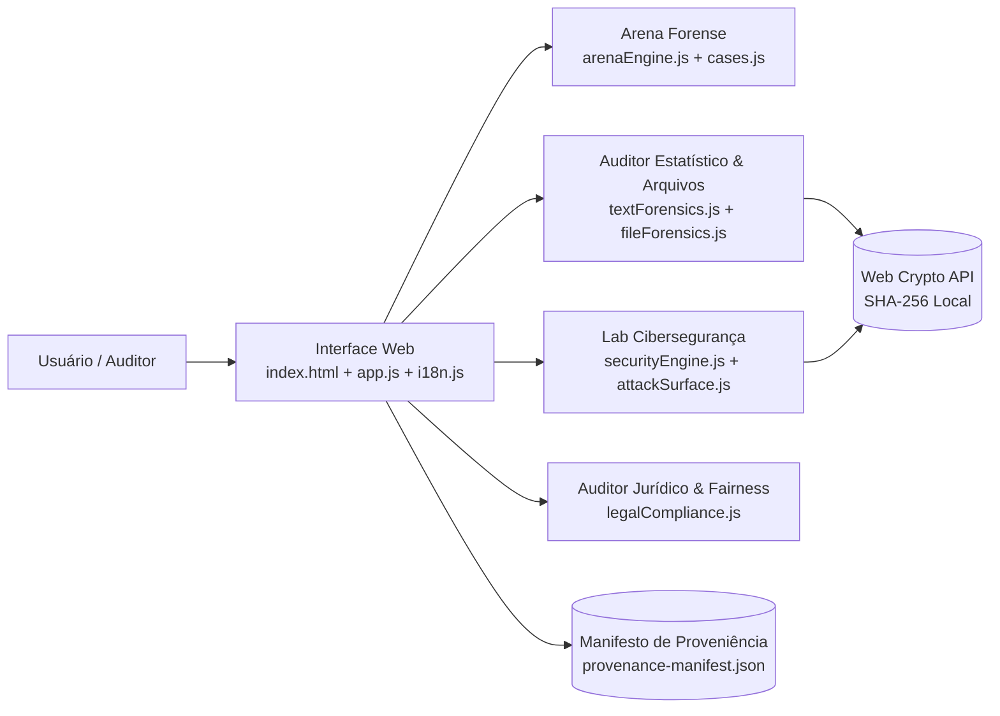
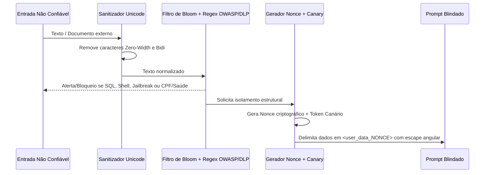

# Arquitetura & System Design — VeritasNatty — Audit & Shield

## 1. Visão Arquitetural (*Privacy by Design*)

O **VeritasNatty — Audit & Shield** opera inteiramente no cliente (**100% client-side**) usando ES Modules nativos e Web Crypto API. Nenhum texto, prompt ou arquivo inspecionado pelo usuário trafega para servidores externos — mitigando o risco de exfiltração de dados pessoais ou sensíveis (LGPD Art. 46).

---

## 2. Fluxo de Blindagem de Prompts & Auditoria Defensiva

---

## 3. Decisões de Engenharia

1. **Separação Estrita `engine/` vs. `ui/`:** os 5 motores lógicos em `src/engine/` não possuem referências ao DOM nem importações específicas de Node.js, permitindo execução idêntica no navegador (Vercel) e na suíte automatizada (`node --test`).
2. **Construção Segura de DOM:** toda renderização em `src/ui/app.js` utiliza `document.createElement`, `textContent` e `replaceChildren()`, eliminando vetores de XSS por injeção de marcação HTML não sanitizada.
3. **Cabeçalhos HTTP de Segurança em Produção (`vercel.json`):** Content Security Policy restrita (`script-src 'self'`, `object-src 'none'`, `frame-ancestors 'none'`), `X-Frame-Options: DENY`, `Referrer-Policy: no-referrer` e `Permissions-Policy` bloqueando sensores.
4. **Cadeia de Custódia Verificável:** `scripts/generate-manifest.mjs` calcula hashes SHA-256 reais no disco e `npm run verify` falha automaticamente no CI se qualquer arquivo de produção divergir do manifesto.
